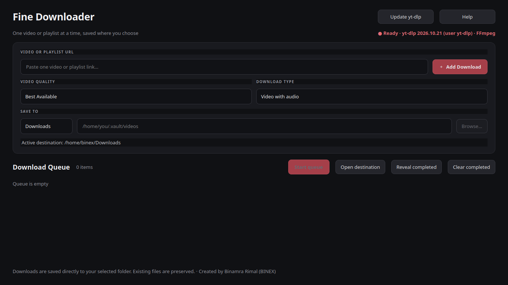
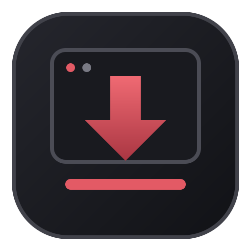

# Fine Downloader

### A simple, lightweight desktop video and audio downloader.

Fine Downloader is a desktop application built with Python and PyQt6, powered by [yt-dlp](https://github.com/yt-dlp/yt-dlp). It provides an intuitive way to download videos, extract audio, manage playlists, and organize multiple downloads through a convenient queue.

<p align="center">
  <strong>Video · Audio · Playlists · Queue</strong>
</p>

---

## Screenshots

### Main Interface

<!-- Save your screenshot as assets/main-window.png -->



### Logo

<!-- Save your screenshot as assets/playlist-queue.png -->



---

## Features

- **Video Downloads:** Download videos in available quality options.
- **Audio Downloads:** Extract audio in supported formats.
- **Playlist Support:** Download videos from supported playlists.
- **Download Queue:** Organize and manage multiple downloads.
- **Progress Tracking:** Monitor download progress, speed, and estimated time remaining where available.
- **Custom Download Locations:** Choose where your downloaded files are saved.
- **Persistent Settings:** Keep preferences between application sessions.
- **Download History:** Access previously recorded download history.
- **yt-dlp Integration:** Leverage yt-dlp's supported media extractors.
- **FFmpeg Integration:** Merge separate audio and video streams and process media where supported.

Available formats, quality options, and features depend on the source and the installed dependencies.

## Installation

### Linux Mint / Ubuntu

1. Open the [Releases](../../releases) page.
2. Download `fine-downloader_1.2.0_amd64.deb`.
3. Open a terminal in the directory containing the downloaded file.
4. Install the package:

   ```bash
   sudo apt install ./fine-downloader_1.2.0_amd64.deb
   ```

5. Launch Fine Downloader from your application menu or run:

   ```bash
   fine-downloader
   ```

The package is intended for compatible 64-bit Intel/AMD Linux systems. Required system dependencies should be installed through the package manager.

## Usage

1. Launch Fine Downloader.
2. Paste a supported video URL.
3. Fetch the available media information.
4. Choose the desired video quality or audio option.
5. Add downloads to the queue as needed.
6. For supported playlists, select the playlist content you want to download.
7. Choose your destination folder and start downloading.
8. Monitor progress through the application's interface.

Exact options depend on the installed version and source website.

## Technology Stack

| Technology | Purpose |
|---|---|
| Python | Application logic |
| PyQt6 | Desktop graphical interface |
| yt-dlp | Media extraction and downloading |
| FFmpeg | Supported media merging and processing |

## Updating yt-dlp

Fine Downloader provides a project-supported mechanism for updating yt-dlp. Refer to the project documentation and update script for instructions.

## Compatibility

- **Available packaged platform:** Linux Mint and compatible Ubuntu-based Linux distributions.
- **Architecture:** 64-bit Intel/AMD (`amd64`).
- **Windows and macOS:** Not advertised as supported unless separately built and tested.
- **Android:** Planned for a future version; no Android support is implied by this release.

## Responsible Use

Use Fine Downloader only for content you own, have permission to download, or are otherwise legally entitled to save.

Respect copyright laws, website terms of service, and applicable access restrictions. Fine Downloader does not grant permission to download particular content.

## Release

**Current version: 1.2.0**

Download the installer from the [GitHub Releases](../../releases) page.

See [CHANGELOG.md](CHANGELOG.md) for version history, if available in this repository.

## License

A license has not been specified in this README. Check the repository for an existing `LICENSE` file before adding or selecting one.

---

<p align="center">
  <strong>Fine Downloader</strong><br>
  Simple. Lightweight. Built for your desktop.
</p>
